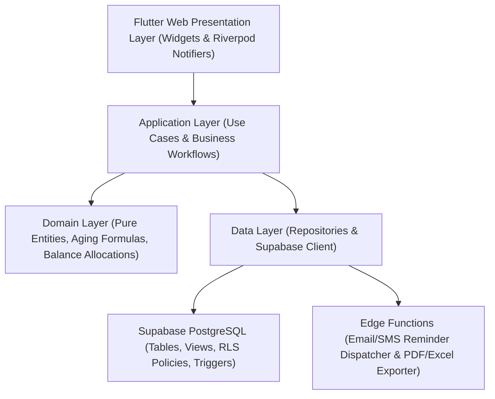

# Architecture Spine — Debit Recovery System

## Design Paradigm

The system implements a **Feature-First Clean Architecture** in Flutter (compiled for Responsive Web, Desktop, and Tablet viewports), connected directly to a high-performance **Supabase PostgreSQL** backend with native **Row-Level Security (RLS)**.



---

## Invariants & Rules

### AD-1: Multi-Tenant Logical Isolation via Supabase PostgreSQL Row-Level Security (RLS)
* **Binds:** FR-01, FR-02, FR-03, FR-04, FR-07, FR-08, FR-16, FR-18.
* **Prevents:** Cross-tenant data leakage, unauthorized access by staff to records outside their tenant organization.
* **Rule:**
  1. Every table (`customers`, `debts`, `payments`, `interaction_logs`, `audit_logs`) has a mandatory `tenant_id UUID REFERENCES tenants(id)`.
  2. Supabase RLS is enabled on all public tables with strict policies checking `tenant_id = (auth.jwt() -> 'app_metadata' ->> 'tenant_id')::uuid`.
  3. Role-based policies restrict sensitive actions: only `admin` can mutate `profiles` and view `audit_logs`; only `finance_officer` and `admin` can execute payment allocation endpoints.

### AD-2: Role-Based Authorization & Session Token Model
* **Binds:** FR-01, FR-02, FR-17, FR-18.
* **Prevents:** Unauthorized feature execution, privilege escalation.
* **Rule:**
  1. User authentication utilizes Supabase GoTrue Auth with secure email/password and salted bcrypt hashing.
  2. Custom claims (`tenant_id`, `role`: `admin` | `recovery_officer` | `finance_officer`) are embedded into the signed JWT access token.
  3. Client-side navigation (`go_router`) enforces route guards based on role claims.

### AD-3: Unidirectional Reactive State Management via Riverpod
* **Binds:** All Flutter Presentation and Application components.
* **Prevents:** Stale table views, untracked mutations, and UI-state race conditions.
* **Rule:**
  1. Flutter widgets observe state strictly via `ref.watch()` on Riverpod `AsyncNotifierProvider` instances.
  2. Direct database access from UI widgets is prohibited. All user actions call Controller methods that dispatch repository requests and yield immutable state models.

### AD-4: Append-Only Auditability for Financial & Operational Events
* **Binds:** FR-07, FR-08, FR-09, FR-16.
* **Prevents:** Deletion or unauthorized alteration of payment records, transaction histories, or user activity logs.
* **Rule:**
  1. `payments`, `interaction_logs`, and `audit_logs` tables have SQL `UPDATE` and `DELETE` revoked for all roles.
  2. Any payment dispute or adjustment requires an explicit compensating transaction record.
  3. The database triggers automatic entries into `audit_logs` whenever customer records, user roles, or debt parameters are modified.

### AD-5: Atomic Transactional Balance Calculation
* **Binds:** FR-04, FR-05, FR-07.
* **Prevents:** Race conditions and discrepancy between total recorded payments and outstanding customer balances.
* **Rule:**
  1. Outstanding debt balances are computed and stored atomically in PostgreSQL using an ACID transaction or database trigger upon payment creation:
     `remaining_balance = principal_amount + approved_adjustments - SUM(payments.amount)`.
  2. The system guarantees 100% calculation accuracy in test suites.

---

## Consistency Conventions

| Concern | Convention |
|---|---|
| **Naming Conventions** | Dart files: `snake_case.dart` · Dart classes: `PascalCase` · Database: `snake_case` |
| **Primary Keys** | `UUIDv4` across all relational database entities |
| **Monetary Values** | Stored as integer cents (`bigint` in SQL, `int` in Dart) or `numeric(12, 2)` to eliminate floating-point rounding errors |
| **Pagination & Sorting** | Server-side pagination with standard parameters: `page`, `page_size` (default 25), `sort_by`, `sort_order` |
| **Timestamps** | ISO 8601 UTC (`YYYY-MM-DDTHH:MM:SSZ`) across API payloads; `timestamptz` in PostgreSQL |
| **Export Engines** | PDF reports generated via `pdf` package; Excel spreadsheets generated via `excel` package |

---

## Stack

| Component | Technology | Version | Purpose |
|---|---|---|---|
| **Frontend Framework** | Flutter Web (Dart) | `^3.13.0` / Dart `^3.1.0` | Responsive cross-platform web client for desktop, tablet, and mobile browsers |
| **State Management** | `flutter_riverpod` | `^2.5.1` | Reactive, compile-safe state management |
| **Routing** | `go_router` | `^14.1.4` | Declarative URL routing with role-based auth guards |
| **Backend & Database** | Supabase (PostgreSQL 15+) | Managed Cloud | Multi-tenant relational database with native RLS, Auth, and Edge Functions |
| **Client SDK** | `supabase_flutter` | `^2.5.6` | Official Supabase client for authentication, data queries, and realtime |
| **Data Visualization** | `fl_chart` | `^0.68.0` | Interactive dashboard charts (recovery trends, payment status breakdowns) |
| **Excel Export** | `excel` | `^4.0.3` | Client-side and server-side `.xlsx` spreadsheet generation |
| **PDF Export** | `pdf` | `^3.10.8` | High-fidelity tabular PDF document generation |
| **Formatting** | `intl` | `^0.19.0` | Currency masks and localized date formatting |

---

## Structural Seed

```text
lib/
  core/
    constants/       # Color tokens, layout breakpoints, spacing
    network/         # Supabase client instance and error handlers
    theme/           # Theme definitions matching DESIGN.md
    utils/           # Currency formatters, date helpers, pagination utilities
  features/
    auth/
      data/          # Supabase GoTrue authentication repository
      presentation/  # LoginScreen, PasswordResetScreen, UserProfileScreen
    dashboard/
      data/          # Dashboard metrics & aggregation queries
      presentation/  # DashboardScreen, MetricCard, RecoveryTrendChart
    customers/
      data/          # Customer repository
      domain/        # Customer entity
      presentation/  # CustomersListScreen, CustomerFormDialog, CustomerDetailScreen
    debts/
      data/          # Debt repository
      domain/        # Debt entity, DPD calculation rules
      presentation/  # DebtLedgerScreen, DebtFormDialog, OverdueFilterBar
    payments/
      data/          # Payment repository (atomic transactions)
      domain/        # Payment allocation logic & receipt models
      presentation/  # PaymentsListScreen, RecordPaymentDialog, ReceiptModal
    recovery/
      data/          # Interaction log & reminder repository
      domain/        # Follow-up scheduling and notification models
      presentation/  # RecoveryActivitiesScreen, LogActionDialog
    reports/
      data/          # Financial report queries & exporters (PDF/Excel)
      presentation/  # ReportsScreen, ReportFilterToolbar, ExportActionButtons
    admin/
      data/          # User management & audit log repository
      presentation/  # UserManagementScreen, AuditLogScreen, SystemSettingsScreen
  main.dart          # Entry point, Supabase initialization, AppRouter config
```

---

## Capability → Architecture Map

| Capability / Requirement | Implementation Component | Governed By |
|---|---|---|
| **Authentication & RBAC (FR-01, FR-02, FR-18)** | `features/auth/` + `features/admin/` + Supabase Auth | **AD-1, AD-2** |
| **Customer Registry (FR-03, FR-13)** | `features/customers/` + Supabase `customers` table | **AD-1, AD-3** |
| **Debt Ledger & Overdue Engine (FR-04, FR-05, FR-06)** | `features/debts/` + Supabase `debts` table & aging triggers | **AD-1, AD-5** |
| **Payment Recording & Allocation (FR-07, FR-08)** | `features/payments/` + `record_payment()` stored procedure | **AD-4, AD-5** |
| **Recovery Logs & Reminders (FR-09, FR-10)** | `features/recovery/` + `interaction_logs` & Edge Functions | **AD-1, AD-4** |
| **Dashboards & Charts (FR-11, FR-12)** | `features/dashboard/` + `fl_chart` | **AD-3** |
| **Reports & PDF/Excel Exports (FR-14, FR-15)** | `features/reports/` + `pdf` & `excel` packages | **AD-1, AD-3** |
| **Audit Logging (FR-16)** | `features/admin/` + Supabase `audit_logs` append-only table | **AD-1, AD-4** |
| **User Profile & Password Management (FR-17)** | `features/auth/presentation/user_profile_screen.dart` | **AD-2** |

---

## Deferred

1. **Dedicated Native Mobile Apps (iOS/Android):** In v1, the product is delivered as a fully responsive web application; dedicated native app store packaging is deferred to a future milestone.
2. **Automated AI Loan Default Scoring:** Machine learning default prediction models are deferred.
3. **Automated Direct Debit / Bank Account Pulls:** Direct ACH/SEPA auto-debit sweeps are out of scope for v1.
